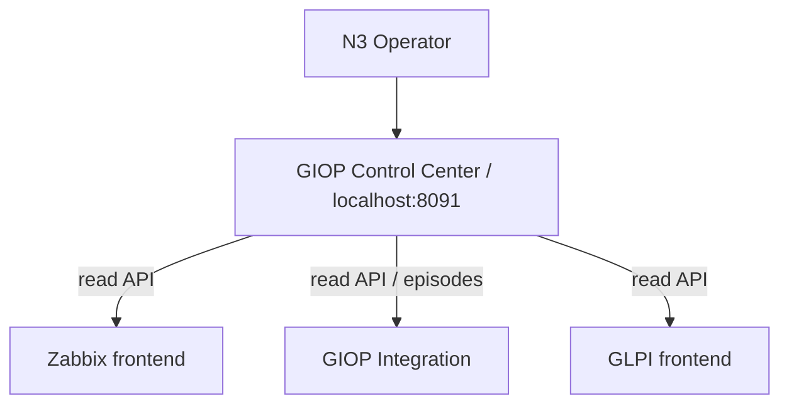
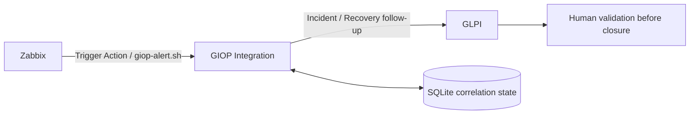

# GIOP-LAB

Local synthetic Infrastructure Operations laboratory. No real municipal operational dataset is represented by the synthetic LAB. The actual physical municipal site count remains TO VALIDATE.

PHASE 1: COMPLETE. PHASE 2: COMPLETE. PHASE 3: AUTOMATIC LIVE MVP VALIDATED (v0.3.0).

PHASE 4: N3 CONTROL CENTER FROZEN AT `giop-lab-v0.4.0` (`42e3cba`).
PHASE 5: OPERATIONAL RUNBOOKS MVP COMPLETE AND LOCALLY VALIDATED; `giop-lab-v0.5.0`.

| Portfolio progression | Capability | State |
| --- | --- | --- |
| v0.1 Observability | Zabbix detects synthetic workload outage / Recovery | Complete |
| v0.2 ITSM / CMDB | GLPI synthetic inventory and Incident lifecycle | Complete |
| v0.3 Event-to-Incident Automation | Persistent Zabbix → GLPI correlation and human validation | Frozen: giop-lab-v0.3.0 |
| v0.4 N3 Control Center | Read-only operations dashboard using current LAB APIs | Frozen: giop-lab-v0.4.0 |
| v0.5 Operational Runbooks | Diagnose, collect evidence, approve fixed LAB recovery, validate and audit | Local release: giop-lab-v0.5.0 |

## Phase 5 — Operational Runbooks

Monitoring alone is not operations. Three operator-local PowerShell runbooks add
service checks, sanitized incident diagnostics and explicitly approved recovery of
only the synthetic `web-workload`. Recovery defaults to a plan; `-Execute` is
required. Zabbix → Integration → GLPI remains responsible for Incident/Recovery
evidence, with human validation before closure. No autonomous remediation or
production readiness is claimed.

```powershell
powershell -NoProfile -ExecutionPolicy Bypass -File scripts/runbooks/Invoke-GiopServiceHealthCheck.ps1
powershell -NoProfile -ExecutionPolicy Bypass -File scripts/runbooks/Collect-GiopIncidentDiagnostics.ps1
powershell -NoProfile -ExecutionPolicy Bypass -File scripts/runbooks/Invoke-GiopControlledRecovery.ps1
```

The last command is **dry-run only**. Review local `artifacts/runbooks/<execution-id>/`
before approving an action. Control Center's [Operational Runbooks](http://localhost:8091/runbooks)
catalog is read only, with no browser Execute button. See the
[Phase 5 demo, apply command and limitations](docs/demo/phase5-operational-runbooks.md).

## Phase 4 — GIOP N3 Control Center

A dark operations dashboard makes the complete LAB workflow visible: source health,
current pilot Problem state, infrastructure inventory, event timeline and persistent
Zabbix-to-GLPI Incident correlation. Values come from current LAB APIs;
**SYNTHETIC LAB** labels distinguish the demonstration from municipal production.

One additional stateless service uses Python, FastAPI, Jinja2, HTML/CSS and vanilla
JavaScript. Credentials stay server-side. It performs read-only aggregation;
the existing Integration remains the owner of event persistence and GLPI writes.



With the base LAB and Phase 3 Integration running and `.env` configured:

```powershell
docker compose --env-file .env -f docker/docker-compose.control-center.yml up -d --build
```

Open [localhost:8091](http://localhost:8091). Pages: Overview, Infrastructure,
Incidents and Event correlation. Data refreshes every 20 seconds without a page
reload. Source failures display Unavailable rather than invented zero counts.
Counts/listing windows have scope labels; no lifetime deduplication counter is claimed.
See the [Phase 4 demo and limitations](docs/demo/phase4-control-center.md).

The container joins only existing Zabbix frontend, GLPI frontend and Integration
webhook application networks, binds `127.0.0.1:8091`, and has no persistent volume,
database network/access or Docker socket. This is a local portfolio MVP.

Phase 1 provides Zabbix observability of a controlled Nginx workload. The operator validated the 2026-10-02 outage from 19:42:31 to 19:44:26 local time (1m55s), final problem RESOLVED and smoke result `lab.web.status [s|1]`: PASS.

Phase 2 provides GLPI 11.0.9 ITSM/CMDB with MySQL persistence. Validated seed: 41 Locations, 127 Computers, 51 NetworkEquipment and 93 Tickets. Separate GLPI Agent 1.20 inventory discovered `GUA-LAB-INVENTORY-001`, Computer ID 182. 127 seeded + 1 discovered = 128 conceptual LAB Computers. The endpoint remained ID 182 after `lab-down` / `lab-up`: persistence PASS.

## Local operation

1. Copy `.env.example` to `.env` and replace every `CHANGE_ME` value with a strong local secret. Keep `.env` ignored.
2. Run `./scripts/lab-up.ps1`.
3. Open Zabbix at http://localhost:8080 (Admin with local `ZABBIX_ADMIN_PASSWORD`) and GLPI at http://localhost:8081 with locally configured credentials.
4. Run `./scripts/lab-smoke-test.ps1` and `./scripts/glpi-smoke-test.ps1` when runtime checks are needed.

If execution policy blocks invocation, use a process-only bypass: `powershell -NoProfile -ExecutionPolicy Bypass -File scripts/lab-up.ps1`.

`lab-status.ps1`, `glpi-status.ps1` and `lab-logs.ps1 [service]` inspect services. `lab-down.ps1` stops the base stack while retaining volumes. The inventory job has its own Compose file and exits after submission.

For API scripts, configure local `.env` keys `GLPI_API_BASE_URL` (http://localhost:8081), `GLPI_API_USERNAME`, `GLPI_API_PASSWORD`, `GLPI_OAUTH_CLIENT_ID`, `GLPI_OAUTH_CLIENT_SECRET`. The validated API client uses scope `api`; token acquisition and API read returned HTTP 200. `IDENTITY_CONFIRMATION=REQUIRES_USER_SCOPE` is expected.

For inventory, configure separate local `GLPI_INVENTORY_OAUTH_CLIENT_ID` and `GLPI_INVENTORY_OAUTH_CLIENT_SECRET` for OAuth Client Credentials, scope `inventory`. With the base stack running, invoke `docker compose --env-file .env -f docker/docker-compose.inventory.yml up --build --abort-on-container-exit --exit-code-from glpi-inventory-agent`, then read back using `scripts/glpi-agent-inventory-check.ps1`. Do not include credentials in commands, screenshots or committed logs.

## Scope and evidence

Frontends bind only 127.0.0.1 ports 8080/8081; databases expose no host ports. Agent uses only `giop-lab-glpi-frontend`, with no direct database network, host port, privileged mode, host networking, socket or host filesystem mount.

Entity creation was rejected; native Locations hold the synthetic topology. Ticket-to-CI mappings are logical manifest entries because the inspected High-Level API exposed no supported Ticket-Item association route. Historical timestamps were not manipulated. Container inventory has incomplete memory details and no native NetworkPort objects; no missing data is fabricated.

The older `Zabbix server` problem `Linux: Zabbix agent is not available (for 3m)` is unrelated LAB configuration noise to review; no recovery is claimed.

## Phase 3 — automated monitoring to ITSM



The local pilot demonstrates **event-driven IT operations**, **automated incident
creation**, **persistent correlation state**, **deduplication**, **Recovery
correlation**, and **idempotent Zabbix provisioning**. Human validation precedes
closure; the integration does not close tickets automatically.

One FastAPI/Python container uses one worker and a persistent SQLite volume.
Default mode is dry-run; the validated instance runs LIVE. Only host 10683 AND
trigger 25228 maps to Computer 1/entity 0, distinct from inventory Computer 182.
Integration binds localhost port 8090 and joins application networks only.

Start with `docker compose --env-file .env -f docker/docker-compose.integration.yml up -d --build`
after configuring dedicated credentials and the shared secret in ignored `.env`.
Provision with `scripts/Enable-GiopZabbixDelivery.ps1`; `-WhatIf` provides read-only
inspection. See the [MVP demo](docs/demo/phase3-mvp-demo.md) and
[automatic delivery runbook](docs/demo/phase3-automatic-delivery.md).
The internal endpoint is `http://integration:8090/api/v1/zabbix/events`.
Phase 3A documents preserve future hardening proposals.

## Validated automatic MVP evidence (2026-10-05)

All LAB records are synthetic; these IDs are not municipal production data.
Operator-confirmed Zabbix 7.0.31 and LIVE integration completed this architecture:

Synthetic workload → Zabbix detection → Trigger Action → `giop-alert.sh` →
FastAPI integration → SQLite persistence/deduplication → GLPI Incident →
Zabbix Recovery → GLPI Follow-up → operator validation.

The pilot is restricted to host **10683 AND trigger 25228**. Stopping the synthetic
workload produced Zabbix pilot event **37**. The automatic Action delivered it,
the integration persisted **PROBLEM_OPEN**, and GLPI automatically created
**Ticket #95**, titled **GIOP-LAB Zabbix synthetic event 37**.
After workload restoration, Zabbix detected Recovery and the correlated episode
became **RECOVERED_PENDING_OPERATOR_VALIDATION**, with a GLPI Recovery follow-up.
Neither `Send-GiopSyntheticProblem.ps1` nor `Send-GiopSyntheticRecovery.ps1` was
used in this automatic demonstration. Automatic closure is intentionally disabled.
The Recovery event ID and follow-up ID were not supplied; no values are invented.

Automatic provisioning completed; the second run returned **UNCHANGED for all
managed objects**, confirming operator-observed idempotency. Earlier operator LIVE
checks confirmed duplicate Problem/Recovery suppression. Local mocked tests verify
one ticket/one follow-up after duplicates and restart; these fixtures are separate
from event 37 and Ticket 95.

Zabbix displayed approximately UTC-3 while GLPI displayed UTC for the same event.
This LAB presentation difference is non-blocking MVP technical debt.

## Post-MVP technical debt

These items do not block **v0.3.0**; this local pilot is not certified for production:

- Complete API response reconciliation, including ambiguous write outcomes.
- Exhaustive pagination hardening.
- Native GLPI Ticket-CI relation (current mapping is logical/content/state only).
- Full least-privilege audit.
- TLS outside the local LAB.
- HA.
- Larger event-burst validation.
- Timezone normalization.
- Production Entity/topology mapping.

See [project state](PROJECT_STATE.md), [v0.2 architecture](docs/architecture/lab-v0.2.md), [CMDB model](docs/architecture/cmdb-model-v0.1.md), [CI naming](docs/standards/ci-naming-standard.md), [outage runbook](docs/runbooks/RB-LAB-001-service-outage.md) and [GLPI runbook](docs/runbooks/RB-LAB-002-glpi-incident-lifecycle.md). Runtime evidence is operator-supplied; finalization CLI checks are static.
