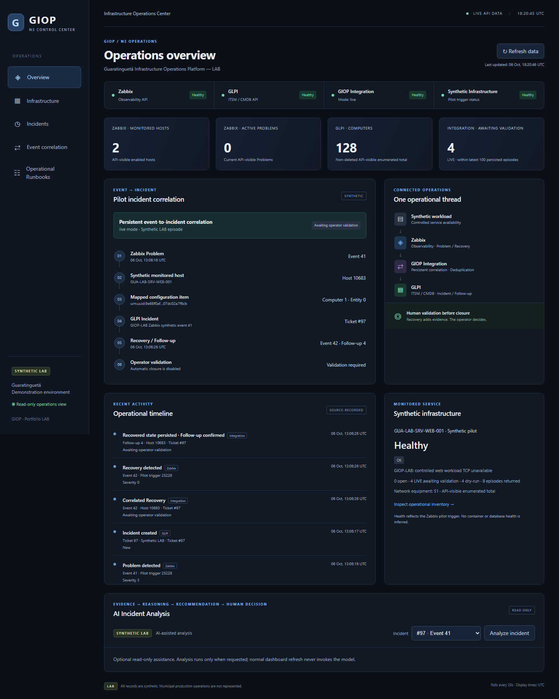
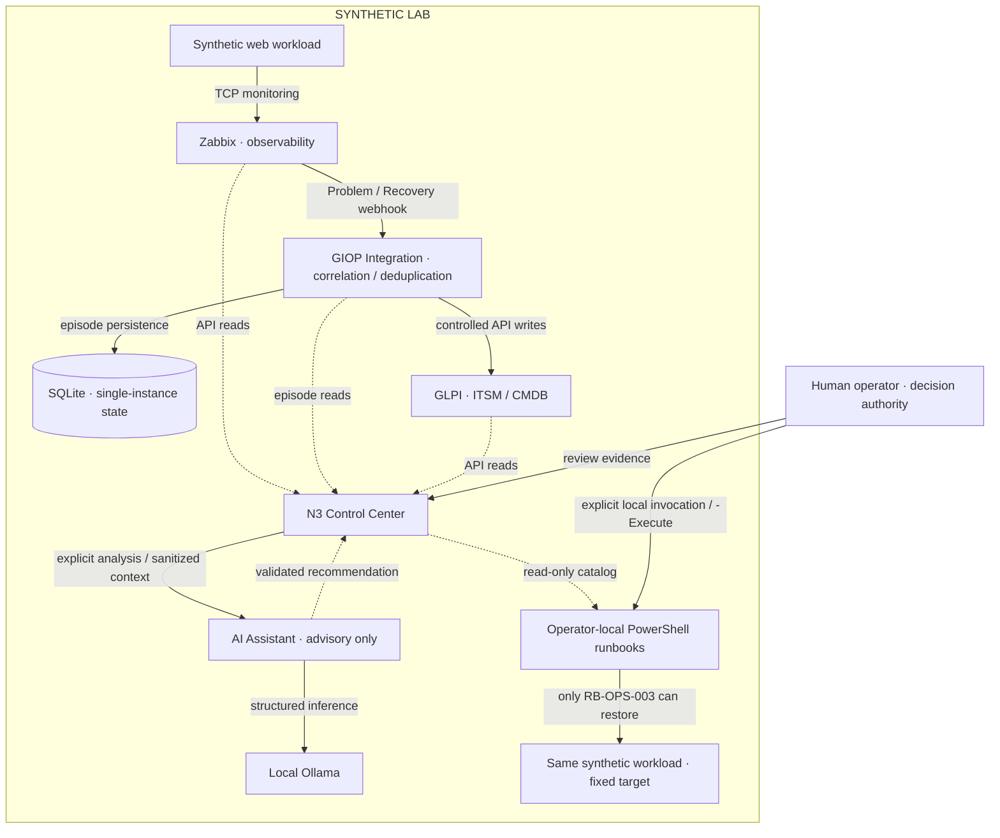
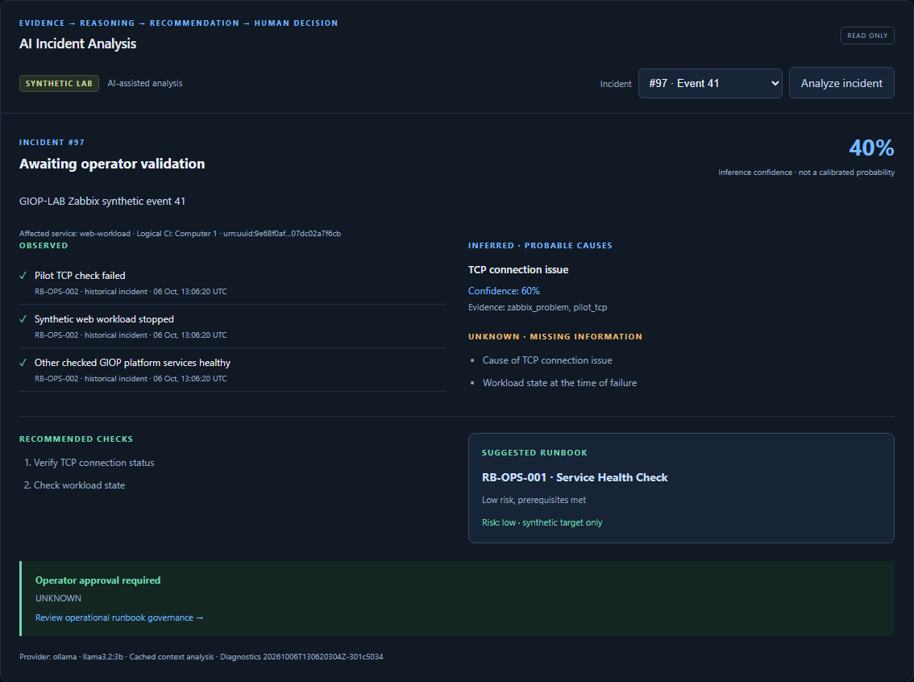

# GIOP

**Guaratinguetá Infrastructure Operations Platform — LAB**

A synthetic infrastructure-operations platform connecting observability, ITSM/CMDB,
event correlation, an N3 Control Center, controlled runbooks and read-only AI analysis.

**This repository is a synthetic laboratory / portfolio implementation. It does not
represent the live municipal production environment.** All demonstrated assets,
incidents and operational records are **SYNTHETIC LAB** data.



## What problem does it solve?

Monitoring, ticketing, inventory and operational response frequently exist as
disconnected tools. GIOP demonstrates a governed workflow connecting them through
a correlated Incident, operator diagnosis, approved recovery and evidence.
Monitoring alone is not operations; AI assistance is not operational authority.

## End-to-End Workflow

Monitor → Detect → Correlate → Incident → Visualize → Diagnose → **Approve**
→ Recover → Validate → AI-assisted analysis.

Recovery adds a GLPI follow-up. It does **not** automatically close the Ticket.

## Architecture



Solid arrows show data flow or the labeled constrained write path; dotted arrows
show reads/presentation. The runbook catalog cannot invoke scripts. AI has no path
to infrastructure actions. Integration uses application APIs, never direct Zabbix or
GLPI database access. [Architecture and decisions](docs/architecture/public-overview.md).

## Key Capabilities

- Zabbix Problem/Recovery detection for one synthetic web-service pilot.
- GLPI synthetic inventory and Incident/Recovery evidence.
- Persistent correlation and duplicate suppression using SQLite.
- Responsive, read-only N3 dashboard with source health and incident timelines.
- **RB-OPS-001:** Service Health Check; **RB-OPS-002:** Incident Diagnostics.
- **RB-OPS-003:** Controlled LAB Recovery, dry-run by default; explicit `-Execute`
  targets only the fixed synthetic `web-workload`. No generic command executor.
- Optional AI: sanitized context, strict schema, OBSERVED / INFERRED / UNKNOWN,
  known-runbook recommendations and mandatory operator review.

## Version Journey

| Tag | Engineering progression |
| --- | --- |
| `giop-lab-v0.1.0` | Observability |
| `giop-lab-v0.2.0` | ITSM / CMDB / Inventory |
| `giop-lab-v0.3.0` | Event-to-Incident Automation |
| `giop-lab-v0.4.0` | N3 Control Center |
| `giop-lab-v0.5.0` | Controlled Operational Runbooks |
| `giop-lab-v0.6.0` | AI-assisted Incident Analysis |

v1.0 is public presentation/release preparation of this validated baseline, not a
new runtime feature phase. Previous tags and [historical evidence](PROJECT_STATE.md)
remain intact. [Roadmap](docs/roadmap.md).

## Demonstrated Scenario

An operator deliberately stops the synthetic web workload. Zabbix detects a Problem;
Integration creates a GLPI Incident; Control Center shows the correlation. Read-only
runbooks assess health and collect evidence. The operator reviews a plan, explicitly
approves recovery, and validates Recovery and the GLPI follow-up.

Historical example: **Problem 41 → Ticket 97 → Recovery 42 → Follow-up 4 → Healthy**.
IDs are instance-specific, not constants for a new demo. The observed inventory was
128 active Computers, 51 NetworkEquipment and 97 visible Tickets, all synthetic.

Real inference passed with **Ollama 0.35.1 / `llama3.2:3b`**. Its schema-valid response
incorrectly treated supplied historical workload state as partly UNKNOWN and recommended
**RB-OPS-001**, not recovery. **Structured validity does not guarantee diagnostic
correctness.** Confidence is model output, not a calibrated probability. The fixture
provider is deterministic test support, **not an LLM**.
[AI trust boundary and real-model limitations](docs/architecture/ai-incident-analysis-v0.1.md).

## Screenshots

Selected local SYNTHETIC LAB captures; runtime directories remain unpublished.

| View | What it demonstrates |
| --- | --- |
| [Overview](docs/assets/control-center-overview.png) | Source health, inventory and pilot state |
| [Incident correlation](docs/assets/incident-correlation.png) | Problem, CI, Incident, Recovery and operator validation |
| [Operational runbooks](docs/assets/operational-runbooks.png) | Read-only governance catalog, no browser execution |
| [Real Ollama analysis](docs/assets/ai-analysis-ollama.png) | Evidence, inference, unknowns, model and approval |



## Technology Stack

Zabbix 7 · GLPI 11 · Python/FastAPI · SQLite · PowerShell · Docker Compose ·
Jinja2 / HTML / CSS / vanilla JavaScript · optional local Ollama.
No agent framework, RAG, vector database or autonomous remediation.

## Safety / Governance

Recovery requires a human invoking a fixed-target local runbook. AI never executes
scripts, calls recovery, modifies Tickets/CMDB or receives infrastructure credentials.
Application containers have no Docker socket or privileged mode. Secrets stay in
ignored local environment files; runtime records, databases, logs and model files
stay outside public source. One real injection check passed, without providing a
general security guarantee. [Security policy](SECURITY.md) ·
[Publication review](docs/release/public-safety-review.md).

## Quick Start

Prerequisites: Docker Desktop with Linux containers, Windows PowerShell, Git;
Python 3.13 for local tests/diagnostic projection. Ollama is optional.

```powershell
Copy-Item .env.example .env
# Configure local secrets and identities; replace every CHANGE_ME before starting.
./scripts/lab-up.ps1
```

This starts the core LAB, **not** the full demo. GLPI initialization, OAuth identities,
synthetic seed, fixed pilot read-back and Zabbix delivery require operator setup.
Follow the [staged setup guide](docs/setup/quick-start.md) before starting Integration,
Control Center or AI. Fresh instances may allocate different IDs; ambiguity fails closed.

| Component | Default local endpoint |
| --- | --- |
| Zabbix | http://localhost:8080 |
| GLPI | http://localhost:8081 |
| Integration health | http://localhost:8090/health |
| N3 Control Center | http://localhost:8091 |

## Testing

Latest regression: **71 tests** — 21 AI, 27 Control Center, 6 Integration (Phase 3),
17 runbook (Phase 5). Fixture tests need no Ollama; mocked runbook tests cause no
outages. Historical live validation verified automatic Incidents, deduplication,
persistence, controlled recovery and follow-up. Real Ollama structured inference and
desktop/mobile browser checks passed. This is LAB verification, not production
certification. [Commands and scope](docs/testing/public-validation.md).

## Repository Structure

| Directory | Responsibility |
| --- | --- |
| `integration/` | Translation, correlation, persistence and GLPI API writes |
| `control-center/` | Read-only aggregation and operations UI |
| `ai-assistant/` | Bounded contract, providers and advisory validation |
| `scripts/runbooks/` | Operator-facing health, diagnostics and recovery |
| `docker/` | Core stack and optional overlays |
| `docs/architecture/`, `docs/runbooks/` | Decisions, boundaries and procedures |
| `docs/demo/`, `docs/portfolio/` | Demonstrations and project summaries |
| `tests/` | Runbook, provisioning and public-release checks |

## Known Limitations

One synthetic pilot, LAB-only topology, local Docker/PowerShell and non-HA state.
CI relationships are logical mappings. Fixed API identities limit fresh-instance
portability. AI quality depends on the model; semantic and injection evaluation is
limited. Production authentication, TLS, egress controls, least-privilege audit and
write-outcome reconciliation need more work. No autonomous remediation is offered.
Municipal production topology and operational records are outside this LAB.

## Roadmap

Public release preparation focuses on clear documentation and safe evidence.
Future hardening in the [roadmap](docs/roadmap.md) is not an implemented production
capability. [5–8 minute demo](docs/demo/v1-public-demo.md) ·
[Portfolio summary](docs/portfolio/project-summary.md).

## License

Licensed under the [MIT License](LICENSE).
