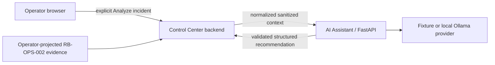

# AI incident analysis v0.1 — SYNTHETIC LAB

Phase 6 adds optional read-only assistance. Evidence → reasoning → recommendation
→ human decision. No production readiness or autonomous remediation is claimed.

## Trust boundary and context

The browser supplies only a positive Ticket ID. The backend assembles context
from its existing read-only snapshot: synthetic Ticket, Zabbix Problem/Recovery,
fixed pilot identity, logical CI mapping, Integration episode and known runbook
catalog. Optional normalized diagnostics are mounted read only. No raw Ticket
description, log, environment dump or provider credentials are supplied.

The operator-only `prepare_diagnostics.py` projects an existing RB-OPS-002 artifact
into bounded enum facts. It validates synthetic marker and pilot identity, drops
unrestricted text and records source SHA256. Generated evidence is Git-ignored.
Diagnostics are historical; current Healthy state is separate. Logical CI mapping
is not a newly created native GLPI Ticket-to-Computer relationship.

Pydantic rejects unknown fields, invalid identities, excessive lengths, invalid
correlation and non-finite confidence. Text is sanitized for credential patterns,
Authorization values and known local secrets before dispatch. Redaction is defense
in depth, not a guarantee against every possible secret encoding.

## Evidence and output

OBSERVED facts have constrained IDs/values, source, timestamp and historical/current
window. Their display statements are generated locally, not accepted from model
prose. Probable causes are INFERRED with referenced supplied evidence and confidence.
Missing information is UNKNOWN. Human validation remains necessary.

The strict output contract includes summary, affected_service, observed_evidence,
probable_causes, recommended_checks, recommended_runbook, missing_information,
operator_notes and overall_confidence. Recommendation IDs and risk must match the
supplied catalog. Executable snippets and tool requests are rejected. Schema validity
does not prove a model's inference correct. The versioned prompt explicitly ignores
embedded instructions in untrusted incident data and prohibits commands/tools.

## Providers and API

`AI_PROVIDER=fixture` requires explicit `AI_FIXTURE_ENABLED=true`. It is a deterministic
rule-based test/UI provider, not a language model; no incident ID hard-codes its answer.
There is no automatic fallback from Ollama to fixture.

`AI_PROVIDER=ollama` uses a configured already-installed local model. The fixed
`/api/chat` request uses the JSON schema, temperature zero, no streaming and no tools.
Only approved local/internal hostnames and port 11434 are accepted. Protocol references:
[Ollama structured outputs](https://docs.ollama.com/capabilities/structured-outputs)
and [Chat API](https://docs.ollama.com/api/chat).
Real validation subsequently passed with operator-installed Ollama 0.35.1 and
llama3.2:3b through host.docker.internal:11434. Mocked adapter tests remain.
The assistant installed/downloaded nothing. Existing host reachability/binding may require
operator configuration; never expose Ollama publicly to make the demo work.

- `GET /health`: configuration/provider metadata.
- `POST /api/v1/analyze`: computation only, no infrastructure mutation.
- `GET /api/v1/analysis/{stable_id}`: cached result.
- Control Center `POST /api/ai/analyze`: internally assembles context and proxies computation.

Canonical context, prompt and provider/model produce a SHA256 cache key. Memory-only
cache: 128 entries, one-hour TTL; no durable audit or database. Page refresh does not
invoke analysis. Explicit repeated analysis reuses cache. Normalized historical facts
remain stable while material current evidence changes invalidate the key.

## Failure and security

AI_UNAVAILABLE, AI_ANALYSIS_INVALID and INSUFFICIENT_EVIDENCE are distinct UI states;
normal incident pages remain usable. Invalid raw output and exceptions are not echoed.
The backend independently validates the provider response and reconstructs evidence.

The AI container receives no infrastructure credentials or .env, Docker socket, host
mount, public port, infrastructure network, database access or privilege. It uses a
non-root user, read-only filesystem and dropped capabilities. Only Control Center
joins its application bridge. This is local network isolation, not an air-gapped
egress firewall or authenticated production API. The service has no remediation,
PowerShell, Docker execution, GLPI/Zabbix mutation or generic tool-calling endpoint.

RB-OPS-003 can be recommended but never invoked. Approval/execution stays outside
the AI workflow. Historical Recovery is explicitly not authorization for another action.

Structured validity does not guarantee diagnostic correctness. Real llama3.2:3b
inference passed strict schema validation without output repair, but was not fully
operationally accurate: historical workload state was supplied and partly reported
as UNKNOWN. It recommended RB-OPS-001 (Service Health Check), not RB-OPS-003.
Model confidence values (40% overall, 60% inferred cause) are not calibrated
probabilities. AI output is advisory; operator review and human decision remain
authoritative. One injection-oriented check is not a general security guarantee.
