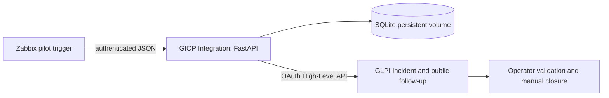

# Phase 3 MVP: monitoring to ITSM in five minutes

Problem: disconnected monitoring and ITSM leave operators copying alarms into tickets.
Solution: an event-driven infrastructure operations workflow connecting observability,
CMDB and ITSM through OAuth, event correlation, deduplication, persistent state,
recovery tracking, Docker and runbooks.



## Automatic delivery and final demonstration

## Validated automatic MVP evidence (2026-10-05)

All LAB records are synthetic; these IDs are not municipal production data.
Operator-confirmed Zabbix 7.0.31 and LIVE integration completed this architecture:

Synthetic workload → Zabbix detection → Trigger Action → `giop-alert.sh` →
FastAPI integration → SQLite persistence/deduplication → GLPI Incident →
Zabbix Recovery → GLPI Follow-up → operator validation.

The pilot is restricted to host **10683 AND trigger 25228**. Stopping the synthetic
workload produced Zabbix pilot event **37**. The automatic Action delivered it,
the integration persisted **PROBLEM_OPEN**, and GLPI automatically created
**Ticket #95**, titled **GIOP-LAB Zabbix synthetic event 37**.
After workload restoration, Zabbix detected Recovery and the correlated episode
became **RECOVERED_PENDING_OPERATOR_VALIDATION**, with a GLPI Recovery follow-up.
Neither `Send-GiopSyntheticProblem.ps1` nor `Send-GiopSyntheticRecovery.ps1` was
used in this automatic demonstration. Automatic closure is intentionally disabled.
The Recovery event ID and follow-up ID were not supplied; no values are invented.

Automatic provisioning completed; the second run returned **UNCHANGED for all
managed objects**, confirming operator-observed idempotency. Earlier operator LIVE
checks confirmed duplicate Problem/Recovery suppression. Local mocked tests verify
one ticket/one follow-up after duplicates and restart; these fixtures are separate
from event 37 and Ticket 95.

Zabbix displayed approximately UTC-3 while GLPI displayed UTC for the same event.
This LAB presentation difference is non-blocking MVP technical debt.

Use the [automatic delivery setup and final demo runbook](phase3-automatic-delivery.md)
for the exact Zabbix 7.0 Media Type, supported macros, notification user, pilot Action,
harmless connectivity check and 12-step outage/recovery procedure. No manual sender
scripts are permitted during the final automatic demonstration.

Default integration mode remains dry-run; the current operator-validated instance is
live. Preserve existing SQLite episodes and use a fresh actual Zabbix event. The
source Compose layer adds only the existing dedicated webhook application network.
`Enable-GiopZabbixDelivery.ps1` prepares the scoped ignored `.env.zabbix-alert` from
`.env` and applies that layer only to Zabbix Server. No secret goes into UI parameters.

## Webhook contract and state

`POST /api/v1/zabbix/events`, `Content-Type: application/json`, header
`X-GIOP-Webhook-Secret` from `.env`, maximum streamed body 32768 bytes.
Required fields: `kind` PROBLEM or RECOVERY; positive decimal string `event_id`,
`host_id`, `trigger_id`; bounded `host` and `trigger`; integer severity 0..5;
`event_time` ISO 8601 with timezone or Unix timestamp. Recovery also requires
distinct `problem_event_id`. Extra fields, malformed JSON and missing fields: 422;
wrong media type: 415; oversized: 413; bad authentication: 401.
Authenticated valid nonpilot events: 202 ignored, no episode or GLPI write.
Pilot success and duplicates: 202 with decision and current episode. Missing original
PROBLEM, conflicting Recovery, mode mismatch or unresolved ticket outcome: 409.
Unconfirmed GLPI writes: 502; do not blindly replay with a new event ID.

`GET /health` returns status, mode, database connectivity and GLPI `not_checked`;
it makes no GLPI probe. Authenticated `GET /api/v1/episodes` returns latest 100
episodes for operator state inspection. No Control Center UI is included.

SQLite volume `giop-lab-integration-state` stores event_id (primary key), trigger_id,
host_id, ci_uid, glpi_ticket_id, external_marker (unique), problem_time,
recovery_event_id (unique), recovery_time, status, mode, followup_id, created_at,
updated_at. Preserve this volume across restarts and backups; never use `down -v`
for a normal demonstration. One service instance and one Uvicorn worker only.
A process lock serializes mutation; committed intent precedes remote POST. Repeated
PROBLEM IDs return the same row/ticket; repeated Recovery returns the row without
another follow-up. A pending write surviving a crash is never automatically retried.

Ticket creation uses type 1 Incident and native `external_id` plus the same marker
in content. OAuth password grant uses only the dedicated identity, scope api, entity
0 nonrecursive and its assigned profile. No priority matrix is guessed; GLPI defaults
apply. Follow-up has `is_private=false`. No solve, close, reopen, technician assignment,
CI modification, remediation or direct database access is implemented.
The supported API is documented by [GLPI](https://help.glpi-project.org/documentation/modules/configuration/general/api/restful-api-v2)
and the previously inspected local v2.3.0 schema. The operator confirmed manual LIVE writes and the automatic MVP demonstration.

## Validation and MVP technical debt

Final MVP regression on 2026-10-05 passed: 22 PowerShell files parsed, repository
structure validated, six Python/FastAPI integration tests passed, offline Zabbix
provisioning tests passed, four Compose configurations validated with placeholders,
working/staged whitespace checks passed, and secret/ignored-file review passed.
The Python tests use mocked GLPI writes; the automatic LIVE result is operator
evidence above. One upstream AnyIO deprecation warning remains non-blocking.
Earlier local verification below is preserved as historical dry-run evidence.

```powershell
python -m venv integration/.venv
integration/.venv/Scripts/python -m pip install -r integration/requirements.txt
Push-Location integration
./.venv/Scripts/python -m pytest -q
Pop-Location
```

Tests cover all eight required scenarios (grouped into six test functions), dry-run,
size/content type, out-of-order Recovery, concurrent repeats and uncertain writes.
Local verification on 2026-10-05: six pytest tests passed; both Compose configurations
validated; Docker image built; container health returned ok in dry-run; sender scripts
persisted event pair 990000001/990000002. After container restart, both senders returned
duplicate and retained the original recovered episode. PowerShell parsing, shell syntax,
repository structure and git diff whitespace checks passed. No live GLPI write was made by those local tests; automatic LIVE evidence above
was supplied separately by the operator.
GLPI writes are mocked in these tests; passing tests do not prove live OAuth rights,
external_id roundtrip, default business rules or native action delivery.

## Post-MVP technical debt

These items do not block **v0.3.0**; this local pilot is not certified for production:

- Complete API response reconciliation, including ambiguous write outcomes.
- Exhaustive pagination hardening.
- Native GLPI Ticket-CI relation (current mapping is logical/content/state only).
- Full least-privilege audit.
- TLS outside the local LAB.
- HA.
- Larger event-burst validation.
- Timezone normalization.
- Production Entity/topology mapping.

On ambiguous outcomes inspect GLPI by marker and preserve SQLite evidence.
Health does not certify GLPI reachability.

Phase 3A documents remain unchanged as future production-hardening proposals.
Their historical implementation gates do not override this explicitly authorized MVP.
No Grafana, remote access, Ansible, AI, RAG, remediation or production HA is included.
