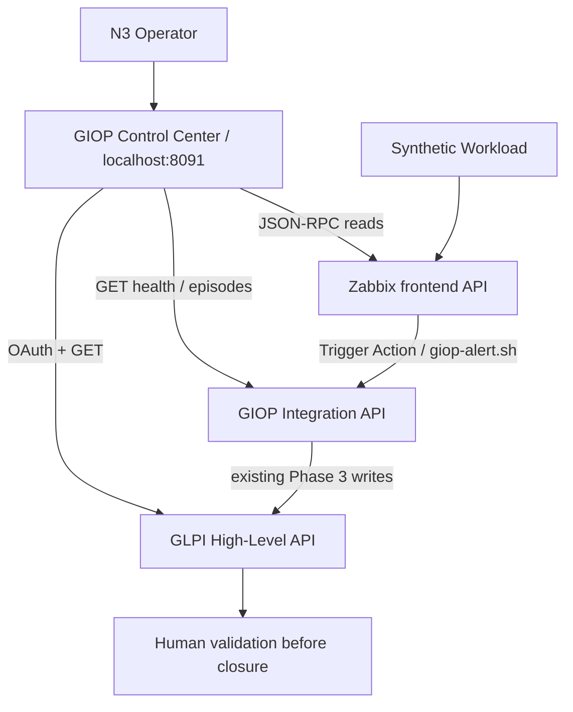

# Phase 4 — GIOP N3 Control Center MVP

Historical Phase 4 evidence is preserved below (Event 37 / Ticket 95 / Recovery 38 /
Follow-up 2 and 95 visible Tickets). The newer synthetic Phase 5 validation is
Problem 41 / Ticket 97 / Recovery 42 / Follow-up 4, with 97 visible Tickets; see
[the Phase 5 demo](phase5-operational-runbooks.md). These are synthetic LAB records,
not municipal production data. The original stop boundary below is historical.

The portfolio Control Center presents the complete monitoring-to-ITSM workflow to
infrastructure professionals and technical reviewers. It uses **current synthetic
LAB API data**, never source-document municipal operational totals or invented
dashboard metrics. It is a local demonstration, not production readiness evidence.

## Architecture and data sources



The new service is Python/FastAPI/Jinja2 with HTML/CSS and vanilla JavaScript.
It is stateless, with a 15-second memory cache and three concurrent source readers.
Browser polling runs every 20 seconds without reloading the document. Credentials
remain server-side; the UI uses local assets only. Dependency failures degrade
their components while successful sources remain visible. Unknown is Unavailable,
never a fabricated zero.

| Source | Reads | Truth boundary |
| --- | --- | --- |
| Zabbix | apiinfo.version, host.get, problem.get, trigger.get, event.get | Counts are API-visible; host rows capped at 100; synthetic infrastructure health uses only pilot trigger 25228 |
| GLPI | OAuth authentication, GET Assets/Computer, Assets/NetworkEquipment, Assistance/Ticket | Entity 0 nonrecursive and assigned profile; bounded enumeration; non-deleted Computers, other listings first 100 rows; asset status is not measured availability |
| Integration | GET /health and authenticated GET /api/v1/episodes | Latest 100 persisted episodes, mode/state and confirmed Ticket/Recovery/follow-up references; not lifetime totals |

Zabbix login/logout and GLPI OAuth are authentication/session operations. All
business calls are read-only; explicit outbound allowlists prohibit arbitrary
resources or Zabbix mutation methods. Dashboard routes are GET only.
No Integration business-event endpoint is called and SQLite is not mounted.

GLPI totals require a bounded scan to reach an empty page with unique strictly
descending IDs. The scan checks at most five pages of 100 records. If it reaches
the limit, the UI labels returned rows as incomplete instead of claiming a global
total. Repeated/overlapping/out-of-order pages fail the component. API metadata
alone is not count proof. This is an MVP guard, not exhaustive pagination hardening.
Incidents show GIOP-marked or episode-linked tickets within the latest 100 visible
Tickets. No global open integration-Incident count is claimed.

CI mapping uses the frozen Phase 3 contract: host 10683 AND trigger 25228 and matching
immutable CI UID → Computer 1/entity 0. This is logical mapping, not discovered
topology or a native Ticket-CI relation. Event/Ticket/Recovery/follow-up IDs are dynamic.

## Start and stop

Prerequisites: Docker Desktop/Compose; base LAB and Integration running; existing
application networks; ignored `.env` configured. From the repository root:

```powershell
docker compose --env-file .env -f docker/docker-compose.control-center.yml up -d --build
```

Open **http://localhost:8091**. Only `127.0.0.1:8091` is published. Application
networks: `giop-lab-frontend`, `giop-lab-glpi-frontend`, `giop-lab-integration-webhook`.
No PostgreSQL/MySQL network, direct DB access, Docker socket, privileged/host mode,
host mount or persistent volume. UID 10002, read-only filesystem, dropped
capabilities, no-new-privileges and `/tmp` tmpfs are configured.

```powershell
docker compose --env-file .env -f docker/docker-compose.control-center.yml down
```

This stops only the Control Center project, preserving the Phase 3 stack.

Compose falls back to existing LAB Zabbix authentication and GLPI Integration
credentials. Optional `CONTROL_CENTER_*` overrides in `.env` support separate read
identities; examples are in `.env.example`. No identity/grant is created or expanded.
Fallback identities may have broader rights than this service uses; least privilege
is not certified. Secrets are runtime server-side environment references only.

## Screens and API

| Page | Purpose |
| --- | --- |
| / | Source status, real KPI cards, latest correlation, source-recorded timeline, architecture and pilot state |
| /infrastructure | Zabbix monitored hosts and GLPI Computers/NetworkEquipment, status/location where supplied |
| /incidents | GIOP-marked/episode-linked GLPI Tickets, status/priority and Recovery correlation |
| /events | Persisted episodes, Problem/Recovery IDs, host/trigger, Ticket, mode/state and timestamps |

Read endpoints: `GET /api/overview`, `GET /api/infrastructure`, `GET /api/incidents`,
`GET /api/events`, `GET /health`. Health proves the presentation service responds;
the overview separately describes dependency check results.

## Five-minute read-only demo

1. Open Overview. Show **SYNTHETIC LAB**, real source statuses, pilot state and
   explicitly scoped host/Problem/asset/episode counts.
2. Follow the latest episode through Zabbix event → synthetic host → logical CI →
   GLPI Ticket → Recovery/follow-up → operator validation. IDs are read dynamically.
3. Show the timeline. Detections, persisted episode observations and Incident creation
   are separate source records. Dry-run observations are labelled, with no claimed write.
4. Open Infrastructure, Incidents and Event correlation. Missing fields are not
   inferred healthy states; bounded collection scopes are displayed.
5. Return to Overview and watch Last updated change after approximately 20 seconds,
   without a page reload. This presentation demo requires no new workload outage.

At local validation: Zabbix 7.0.31, two monitored hosts, zero active Problems, pilot OK;
GLPI enumerated 128 current/non-deleted Computers, 51 NetworkEquipment, 95 Tickets; Integration returned
six episodes (two LIVE recovered awaiting validation and four dry-run). Latest actual
correlation: event 37 → Ticket 95 → Recovery 38 → follow-up 2. Two GIOP-generated
Incidents were visible. These are current synthetic LAB observations, not permanent
fixtures or municipal data. Historical Phase 2 seed evidence remains separate.

Computer queries use the validated High-Level API RSQL `filter=is_deleted==false`
on every page. The unfiltered GLPI collection contains 182 Computer objects; 54
are soft-deleted in the recycle bin. 127 deterministic seeded Computers + 1 GLPI
Agent-discovered Computer (`GUA-LAB-INVENTORY-001`, ID 182, `is_dynamic=true`)
= 128 active LAB Computers. All values are synthetic LAB data. Infrastructure
displays all 128 active Computers within the existing five-page scan bound.

## Validation

```powershell
python -m venv control-center/.venv
control-center/.venv/Scripts/python -m pip install -r control-center/requirements.txt
Push-Location control-center
./.venv/Scripts/python -m pytest -q
Pop-Location
Push-Location integration
./.venv/Scripts/python -m pytest -q
Pop-Location
docker compose --env-file .env.example -f docker/docker-compose.control-center.yml config --quiet
git diff --check
```

The proportional suite covers health, healthy correlation, all three source failures,
no fabricated zero, events/incidents, HTML, read-only routes, secret/field projection
and collection consistency, including server-side soft-delete exclusion across
Computer pages and overview/infrastructure routes. Live pagination completed with
100 + 28 + 0 rows; overview KPI and Infrastructure both expose 128 active
Computers, with NetworkEquipment 51 and Tickets 95 unchanged. Phase 3 six tests must stay green. One upstream AnyIO
deprecation warning is non-blocking. Test fixtures never supply runtime dashboard data.

Local results: **18 Control Center tests passed; all six Phase 3 tests passed**.
Compose config/build/start and all live pages/endpoints passed. Headless Chromium
confirmed desktop/mobile rendering without horizontal overflow, no JavaScript errors,
polling without navigation and graceful browser rendering of a simulated dependency
failure. Secret review scanned 81 tracked/intended files and compared 13 distinct
local credential values without disclosure. No matches were found; secret/runtime
files remain ignored. HEAD and the frozen v0.3.0 tag target are unchanged.

Optional isolated Chromium UI smoke check (development only):

```powershell
control-center/.venv/Scripts/python -m pip install playwright
control-center/.venv/Scripts/python -m playwright install chromium
Push-Location control-center
./.venv/Scripts/python tests/ui_smoke.py
Pop-Location
```

This checks live pages/APIs, local credential values absent in API/DOM, auto-refresh,
desktop/mobile rendering and JavaScript execution. Screenshots are saved to ignored
`artifacts/control-center/phase4-overview.png` and `phase4-mobile.png`.
Playwright is not a runtime dependency or an additional application service.

## Limitations and stop boundary

- Snapshot counts depend on source/profile visibility and bounded scans, not production-wide scope.
- Computer tables display the bounded scan (up to 500 rows); other host/asset/Ticket tables display at most 100 rows; episode metrics cover the returned window.
- Duplicate suppression exists in Phase 3; no duplicate counter/audit history is exposed or invented.
- Current health does not invent historical inventory receipts or service-change events.
- Known service status covers API dependencies and the pilot, not Docker/database inspection.
- Aware timestamps display UTC; unknown source offsets retain a source-timezone label. Normalization remains Post-MVP debt.
- Source failures show Unavailable. A failed dashboard fetch marks the previous browser snapshot stale.
- No portal authentication, remote exposure, native Ticket-CI association, production HA/TLS or least-privilege certification.
- No acknowledgement, closure, assignment, remediation or CMDB changes.

Stop after implementation/validation. No commit, push, tag, production hardening,
Ansible, remote desktop, AI/RAG/Ollama, Grafana, NetBox, advanced topology or production
deployment is authorized.
