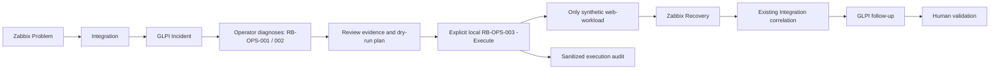

# Phase 5 - Operational Runbooks / Controlled Automation MVP

Baseline: `giop-lab-v0.4.0`, commit `42e3cba`. Working branch:
`phase/5-operational-runbooks`. Local release: annotated tag `giop-lab-v0.5.0`,
commit subject `feat(runbooks): add controlled N3 operational response workflow`.
No push or Phase 6 is part of this finalization.
All hosts, assets, Incidents and evidence here are SYNTHETIC LAB data.

Monitoring alone is not operations. This portfolio connects observability, ITSM,
CMDB, event correlation and operator visibility to diagnosis, deliberate approval,
controlled recovery, validation and evidence. It does not imply autonomous
remediation or production readiness.



## Operator demo commands

Run from the repository root with the existing base LAB, LIVE Integration and
Control Center already running. The pilot host/trigger/CI mapping and automatic
Phase 3 delivery must already be configured. Credentials remain in ignored `.env`.

```powershell
# 1. Healthy baseline; inspect PASS for every component.
powershell -NoProfile -ExecutionPolicy Bypass -File scripts/runbooks/Invoke-GiopServiceHealthCheck.ps1

# 2. Intentionally stop ONLY the approved synthetic workload.
docker compose --env-file .env -f docker/docker-compose.yml stop web-workload

# 3. Wait for actual Problem 25228 and automatic GLPI Incident.
# Open http://localhost:8091/ and inspect the current correlated event/Ticket.
powershell -NoProfile -ExecutionPolicy Bypass -File scripts/Test-GiopIntegrationHealth.ps1 -State

# 4. Diagnose; the health command deliberately returns exit 1 for DEGRADED.
powershell -NoProfile -ExecutionPolicy Bypass -File scripts/runbooks/Invoke-GiopServiceHealthCheck.ps1
powershell -NoProfile -ExecutionPolicy Bypass -File scripts/runbooks/Collect-GiopIncidentDiagnostics.ps1

# 5. Review the exact execution's summary.md, summary.json and diagnostics.txt.
# Then inspect the plan (no action):
powershell -NoProfile -ExecutionPolicy Bypass -File scripts/runbooks/Invoke-GiopControlledRecovery.ps1

# 6. Operator explicitly approves the printed fixed target/action:
powershell -NoProfile -ExecutionPolicy Bypass -File scripts/runbooks/Invoke-GiopControlledRecovery.ps1 -Execute -WaitSeconds 180

# 7. Verify PASS, actual Recovery reference and confirmed GLPI follow-up.
powershell -NoProfile -ExecutionPolicy Bypass -File scripts/runbooks/Invoke-GiopServiceHealthCheck.ps1
powershell -NoProfile -ExecutionPolicy Bypass -File scripts/Test-GiopIntegrationHealth.ps1 -State
```

Review the same Ticket; it remains open for human validation. Control Center must
return to Healthy after its cache/polling window. Inspect `/runbooks` for purpose,
risk and mode. Latest executions are explicitly unavailable there: local artifacts
are not mounted in the application. There is no Execute button or new API.

If the demonstration cannot finish, restore only the intentionally stopped workload
with `docker compose --env-file .env -f docker/docker-compose.yml start web-workload`,
then inspect the partial audit and existing delivery state. This is operator demo
cleanup, not an automatic remediation policy. Do not fabricate events or delete state.

## Audit and architecture

Three PowerShell entry points share `scripts/lib/GiopRunbooks.ps1`. Only
RB-OPS-003 can call the fixed local Compose start/restart. APIs use reads except
existing authentication/session operations. No application Docker socket, privileged
container, new service/network/database, or Integration write behavior is introduced.
The catalog is a static read-only page; aggregation remains unchanged.

Every execution records execution_id, runbook_id, environment, UTC started/finished,
operator_requested, mode, fixed target, preconditions, actions, results, validation
and overall_status. Apply records add requested_action, action outcome, observed
Recovery and Integration/GLPI references. Artifacts live in ignored
`artifacts/runbooks/<execution-id>/`; do not confuse offline mock records with live evidence.

## Validation

```powershell
powershell -NoProfile -ExecutionPolicy Bypass -File tests/Test-GiopRunbooks.ps1
Push-Location integration
./.venv/Scripts/python -m pytest -q
Pop-Location
Push-Location control-center
./.venv/Scripts/python -m pytest -q
./.venv/Scripts/python -u tests/ui_smoke.py
Pop-Location
control-center/.venv/Scripts/python tests/Review-GiopRunbookSecrets.py
git diff --check
```

Offline tests mock Docker/API effects; they do not cause outages. Live validation
uses an actual controlled Problem/Recovery and reads the resulting GLPI follow-up.
Runtime counts and IDs may grow with new real LAB incidents; Phase 4's historical
95 Tickets / Event 37 evidence is not a permanent assertion for future demonstrations.

## Observed live result (2026-10-06 UTC)

Actual final sequence: **Problem 41 → Ticket 97 → Recovery 42 → Follow-up 4**.
Health and diagnostics reported DEGRADED. Dry-run passed without an action; explicit
apply started only web-workload, then confirmed fresh Zabbix Recovery and the same
episode's API-read GLPI follow-up. Final health and Control Center returned Healthy.
Apply audit: `artifacts/runbooks/20261006T130622788Z-7d82a8f6/summary.json`.
Diagnostics: `artifacts/runbooks/20261006T130620304Z-301c5034/`.
Plan: `artifacts/runbooks/20261006T130621479Z-af7677a8/`.
The ignored `phase5-live-demo.json` cross-references the six live execution records.

An initial interrupted validation exposed Docker progress on stderr in Windows
PowerShell 5.1. Cleanup restored the workload, and existing automation recorded
Problem 39 / Ticket 96 / Recovery 40 / Follow-up 3. The corrected native-command
adapter uses exit status; both actual episodes remain in the LAB. Current counts
are 128 active Computers, 51 NetworkEquipment and 97 Tickets. These are synthetic
current observations, not permanent fixture totals.

Offline results: **17 runbook cases, 20 Control Center tests and six Phase 3 tests**.
Browser checks cover desktop, 320/390/540/768px mobile navigation, runbook catalog,
read-only APIs, polling and partial failures. Secret review includes all generated
JSON/Markdown/text evidence and intended Git files. `git diff --check` passes.

## Limitations

Windows PowerShell 5.1/local Docker CLI only; one frozen pilot and Compose definition.
LIVE Integration is required even for a recovery plan. No remote execution or artifact
ingestion, log bundle, generic targeting, distributed lock, rollback automation,
approval engine, Ansible, AI/RAG/Ollama or production orchestration. Source reads are
sequential snapshots, not atomic transactions; a failure or concurrent operator change
can leave validation partial. Docker CLI availability is a local operator prerequisite.
Runbooks do not close/assign Tickets; the operator validates the service and Incident.
